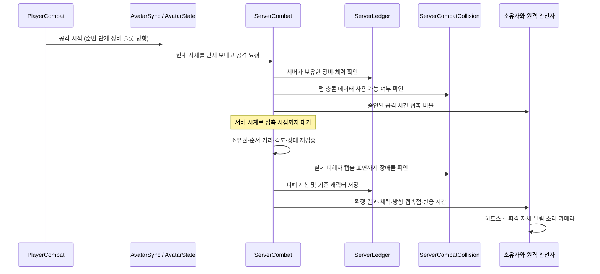

# 근접 전투 구현 및 검증 기록

전투 구현 기록일: 2026-10-29. 손 모양 정정: 2026-10-30, 아래 8절. 경로는 저장소 루트 기준이다.

기존 플레이어·포즈·체력·네트워크 구조에 잽 → 스트레이트 → 훅, 피격 반응, 밀림, 넘어짐/일어나기, 캐릭터별 히트스톱, 소리와 카메라 반응을 연결했다. 연결 중인 플레이어 간 피해는 서버가 확정한다.

작업 시작 시 이미 변경된 경로는 114개였다. 아래 목록은 기존 변경 파일과 겹치는 경로를 포함해 이번에 전투 연결을 수정한 범위다. 기존 캐릭터 아트, 맵, 임포터 작성 내용은 보존했으며 커밋·푸시는 수행하지 않았다.

## 1. 수정한 기존 파일

이번 작업이 수정한 기존 파일은 다음 16개다. 이미 수정되어 있던 파일에서는 기존 작성 내용을 유지하고 전투 연결 부분을 확장했다.

| 경로 | 이번 변경의 역할 |
| --- | --- |
| `CompanyGame/Assets/Scripts/Player/PlayerCombat.cs` | 입력 차단, 3단 콤보와 1회 입력 버퍼, 접촉 시점 판정, 서버 요청/확정 처리, 공통 시간·피해·맨손 거리 계산 |
| `CompanyGame/Assets/Scripts/Player/PlayerMovement.cs` | 기존 이동에서 공격 중 감속·방향 전환, 피격 중 제어 제한, 충돌을 고려한 밀림 적용 |
| `CompanyGame/Assets/Scripts/Player/PlayerStats.cs` | 기존 체력·Changed/Damaged/Collapsed 이벤트를 보존하면서 서버 체력·피해 적용 API 추가 |
| `CompanyGame/Assets/Scripts/Player/PlayerCameraController.cs` | 기존 카메라 계산에 소유 플레이어의 짧은 타격 흔들림 추가 |
| `CompanyGame/Assets/Scripts/Player/PlayerHeldItem.cs` | 기존 1인칭 팔 표현에 왼팔 잽/훅, 오른팔 스트레이트와 전투 자세 연결 |
| `CompanyGame/Assets/Scripts/World/DaldongneAvatarMotion.cs` | 기존 단일 포즈 소유자에 8종 전투 자세, 방향성 피격, 주먹·팔·몸통 보정, 선택적 클립 레이어 추가 |
| `CompanyGame/Assets/Scripts/Player/RemoteAvatarView.cs` | 원격 콤보·반응 시계, 확정 타격 히트스톱, 사망 상태 유지, 차량 탑승 중 아바타 캡슐 비활성화 |
| `CompanyGame/Assets/Scripts/Player/AvatarState.cs` | 서버만 보낼 수 있는 공격/결과/피격/체력 이벤트, 원격 소리, 기존 클라이언트 직접 피해 경로 차단 |
| `CompanyGame/Assets/Scripts/Player/AvatarSync.cs` | 기존 공격 이벤트를 요청 전송에 연결하고 요청 직전 소유 아바타 자세 및 변경된 인벤토리 배치 전송 |
| `CompanyGame/Assets/Scripts/Net/SyncClient.cs` | 소유 엔티티 이벤트보다 변경 상태를 먼저 전송하여 공격 시점의 위치/자세 순서 보장 |
| `CompanyGame/Assets/Scripts/NetCore/GameServer.cs` | 기존 이벤트 중계 전에 필터 실행, 서버 서비스가 현재 엔티티 ID를 읽는 API 추가 |
| `CompanyGame/Assets/Scripts/Player/ServerWorld.cs` | 기존 서버 월드 수명에 전투 서비스 생성/Tick/종료 연결, 식사 결과 후 체력 재동기화 |
| `CompanyGame/Assets/Scripts/Player/ServerLedger.cs` | 기존 소유 아이템 검증·식사 성공 처리와 서버 체력 연동, 저장 요청으로 체력 위조 방지 |
| `CompanyGame/Assets/Scripts/Player/CharacterSync.cs` | 기존 캐릭터 저장 형식 v2에 서버 전투 체력 추가, v1 읽기 호환 유지 |
| `CompanyGame/Assets/Scripts/Editor/Net/AvatarSyncQA.cs` | 기존 아바타 동기화 QA를 새 이벤트에 맞춤, Editor를 종료하지 않는 격리된 TCP 실행 경로 추가 |
| `CompanyGame/Assets/Resources/Player.prefab` | 공유 플레이어의 전투/반응/피드백 구성과 최종 맨손 기본값 연결 |

`CharacterQA.cs`와 캐릭터 임포터의 기존 변경은 이번 목록에서 제외했다. 별도 씬 플레이어나 새 네트워크 Behaviour 인덱스를 추가하지 않았다.

## 2. 신규 파일 및 생성 이유

새 C# 파일은 7개이며 각각 `.meta`를 포함한다.

| 경로 | 독립 책임 및 기존 코드와 연결 |
| --- | --- |
| `CompanyGame/Assets/Scripts/Player/PlayerHitReaction.cs` | 캐릭터별 반응 시간·행동 제한·밀림·히트스톱. 체력은 PlayerStats/Damageable, 실제 이동은 PlayerMovement, 뼈 자세는 DaldongneAvatarMotion이 계속 담당한다. |
| `CompanyGame/Assets/Scripts/Player/CombatFeedback.cs` | 캐릭터 위치의 공격/피격 소리와 기존 카메라의 흔들림 요청. 피해 계산이나 이동을 소유하지 않는다. |
| `CompanyGame/Assets/Scripts/Player/ServerCombat.cs` | 서버의 요청 검증·접촉 예약·표적 선택·피해 확정. ServerWorld가 소유하는 일반 서비스이며 별도 서버 관리자나 저장소를 만들지 않는다. |
| `CompanyGame/Assets/Scripts/Player/ServerCombatCollision.cs` | 로드된 맵 또는 격리된 물리 씬에서 월드 장애물 조회. 게임플레이 씬을 실행하지 않고 전용 서버에서도 벽 판정을 제공한다. |
| `CompanyGame/Assets/Scripts/Editor/Combat/CombatCollisionBuilder.cs` | 저장된 빌드 맵의 충돌 요소만 서버용 리소스로 내보내는 Editor 도구. 맵 원본을 저장하지 않는다. |
| `CompanyGame/Assets/Scripts/Editor/Combat/CombatRuntimeQA.cs` | 실제 프레임·물리·공유 캐릭터·카메라를 사용하는 임시 Play Mode 수용 검증 및 화면 기록 |
| `CompanyGame/Assets/Scripts/Editor/Net/ServerCombatQA.cs` | 실제 프로토콜과 조절 가능한 서버 시계로 요청 위조·중복·접촉·벽·체력 저장을 검증 |

추가 파일/폴더:

- `CompanyGame/Assets/Scripts/Editor/Combat.meta`: 새 Editor 도구 폴더의 Unity 식별자.
- `CompanyGame/Assets/Resources/CombatCollision.meta`: 생성 충돌 리소스 폴더의 Unity 식별자.
- `CompanyGame/Assets/Resources/CombatCollision/manifest.json` 및 `.meta`: 맵 경로, 생성 리소스 경로, 의존성 해시와 충돌 요소 수 기록.
- `Docs/MeleeCombat.md`: 이 구현·설정·검증 문서.

### 서버 충돌 리소스

아래 11개 프리팹과 각각의 `.meta`를 생성했다. 경로 앞에는 `CompanyGame/Assets/Resources/CombatCollision/`가 붙는다.

| 파일 | Collider 수 |
| --- | ---: |
| `daldongnaemap_d9b30041.prefab` | 3,663 |
| `DaldongnePocketGarden_952c7c13.prefab` | 48 |
| `NightlifeDistrict_81a4ca5c.prefab` | 777 |
| `CivicDistrict_953c7272.prefab` | 915 |
| `BusinessDistrict_c6e92700.prefab` | 1,711 |
| `CoastalResidentialDistrict_71b1577d.prefab` | 652 |
| `LuxuryResidentialDistrict_cee53279.prefab` | 724 |
| `ConvenienceStoreInterior_faf73564.prefab` | 35 |
| `GoshiwonInterior_aedbf340.prefab` | 138 |
| `CivicLibraryInterior_d6125f99.prefab` | 268 |
| `HandaeHQLobby_f8f340ea.prefab` | 143 |
| **합계** | **9,074** |

현재 폴더의 프리팹·메타·manifest 합계는 **15,054,945 bytes, 약 15 MB**다. 원본 Mesh/Terrain 리소스 참조의 전체 빌드 용량은 이 수치에 포함하지 않는다.

Play Mode를 종료한 뒤 **CompanyGame → Combat → Build Server Map Collisions** 메뉴로 재생성한다. 활성화된 Build Settings 게임 맵을 대상으로 하며 Title은 제외한다. 맵 충돌 구조를 바꾸거나 서버를 배포하기 전에 재생성해야 한다. 출처 씬은 Preview Scene으로 읽고 원본 씬에는 저장하지 않는다.

## 3. 재사용한 기존 클래스·메서드

| 기존 소유자/API | 재사용 방식 |
| --- | --- |
| `PlayerCombat.TryAttack`, `AttackPerformed` | 기존 음식/차량/무기/맨손 입력 경로를 유지하고 근접 공격의 시간·콤보 처리 확장 |
| `PlayerMovement`, `CharacterController.Move` | 입력 이동과 벽을 고려한 밀림의 실제 위치 변경 담당 |
| `IDamageable.TakeDamage`, `Damageable`, `PlayerStats` | 오프라인 피해 수신 및 기존 체력/HUD 이벤트 유지 |
| `DaldongneAvatarMotion`, `PlayClip`, 기존 Humanoid Avatar/뼈 | 걷기·앉기·자전거·선택적 클립 위에 같은 소유자가 전투 자세 적용 |
| `PlayerHeldItem`, `PlayerCameraController` | 기존 1인칭 팔과 카메라에 타격 표현 연결 |
| `AvatarSync`, `AvatarState`, `NetTransform`, `SyncClient.SendEvent` | 기존 엔티티와 전송 계층으로 요청 및 확정 이벤트 전달 |
| `WorldStateSync.FlushBooks` | 공격 직전 기존 인벤토리 변경 전송을 먼저 처리하여 장비 슬롯 이동 직후의 요청 순서 보장 |
| `GameServer.SendServerEvent`, 기존 Spawn/State 필터 | 서버 출처의 결과 전송과 소유권·아바타 수 제한 |
| `ServerLedger.Bag/Store`, `InventoryLedgerRules.TryEat`, `InventorySnapshot`, `TradeCatalog` | 서버 장비 소유권 확인, 기존 식사 성공 이후 회복, 기존 캐릭터 저장 |
| `CharacterSync.Read/Encode`, 기존 월드 캐릭터 content | 서버 체력을 기존 저장 데이터에 추가 |
| `WorldStateSync.Say` | 기존 시스템 메시지 경로로 확정 피격 알림 표시 |

돈 지급·차감, 인벤토리 제거, 거래 기록을 전투 코드에서 새로 구현하지 않았다. 음식 1개 제거는 기존 원장 함수가 성공했을 때만 수행되며 그 결과에 따라 서버 체력을 회복한다.

## 4. 변경된 데이터 흐름

### 연결 중인 플레이어 간 전투



요청에는 피해량이나 공격 대상 ID를 싣지 않는다. 서버는 요청 소유자, 증가하는 순번, 콤보 순서, 재공격 시간, 기절 상태, 실제 보유 장비, 유한한 방향값과 맵을 검사한다. 한 요청은 접촉을 한 번만 처리한다. 공격 준비 중 맞으면 예약된 접촉이 취소된다.

접촉 시 서버가 유한한 공격 선분/반경과 피해자 수직 캡슐의 교차, 최대 거리·시야각·벽을 함께 확인한다. 넓은 각도 안에 있다는 이유만으로 맞지 않는다. 결과 접촉점은 피해자 캡슐 표면이며 얼굴/몸통 반응은 실제 접촉 높이로 결정한다. 밀림 방향은 피해자 루트에서 공격자 루트를 뺀 수평 방향이다.

`AvatarState`의 새 이벤트 번호는 요청 3, 공격 승인 4, 결과 5, 피격 6, 체력 7이다. 클라이언트는 결과 이벤트의 `sender == 0`만 처리한다. 기존 직접 Punch/Hit 이벤트(1/2)는 서버 필터에서 차단하며 `AvatarState.TakeDamage`는 원격 플레이어에게 직접 피해를 보내지 않는다. 총기 역시 서버가 소유 장비의 사거리·피해·속도와 시선을 확인하는 경로를 사용한다.

체력은 서버 메모리 캐시와 기존 캐릭터 content v2에 저장한다. 클라이언트 저장 요청으로 이 값을 덮을 수 없다. 식사 실패 시에도 서버 체력을 다시 보내 로컬 예측을 교정한다. 주기적인 체력 상태 전송으로 늦게 들어온 관전자도 체력 0의 쓰러짐을 복원한다.

### 오프라인과 표현

연결되지 않은 경우 기존 `IDamageable` 경로를 사용하되 공격 시작 즉시가 아닌 접촉 프레임에 한 번 판정한다. 동일 대상의 여러 Collider가 피해를 중복시키지 않는다. 허공 공격에는 피격음·피해·타격 히트스톱이 발생하지 않는다.

포즈 이름은 `Punch_Jab`, `Punch_Straight`, `Punch_Hook`, `Hit_Face`, `Hit_Body`, `Hit_Heavy`, `Knockdown`, `GetUp`이다. 서버 확정 공격/피격을 원격 캐릭터에도 적용하며 공격자는 스윙음을, 피해자는 한 번의 공간 피격음을 낸다. 체력 상태만 재전송될 때 소리를 재생하지 않는다.

## 5. 중복 구현 여부

- 플레이어 이동 소유자는 `PlayerMovement`, 뼈 포즈 소유자는 `DaldongneAvatarMotion`, 로컬 체력/HUD 소유자는 `PlayerStats`로 유지했다.
- `ServerCombat`은 기존 `ServerWorld` 안에서 동작하며 서버 루프·연결·맵 매니저·플레이어를 별도로 만들지 않는다.
- 서버 충돌 프리팹에는 Transform과 Collider만 허용한다. 게임플레이 스크립트나 두 번째 플레이어를 실행하지 않는다.
- 시간·피해·맨손 훅 거리 배율은 `PlayerCombat` 정적 함수로 서버와 공유한다. 인벤토리 변경과 캐릭터 저장은 기존 원장을 사용한다.
- 히트스톱은 해당 캐릭터의 전투/포즈 시계만 멈춘다. `Time.timeScale`이나 전체 게임 시간을 변경하지 않는다.

## 6. 기존 기능·호출부 영향 및 설정

### Inspector 기본값

서버는 시작할 때 `Resources/Player.prefab`의 `PlayerCombat` 값을 읽는다. 플레이 중 개별 인스턴스 값을 바꿔도 이미 실행된 서버 설정이 바뀌지는 않는다.

| 컴포넌트/항목 | 기본값 | 의미 |
| --- | --- | --- |
| PlayerCombat: punchDamage | 10 | 맨손 기준 피해 |
| punchRange / punchRadius | 0.52 m / 0.10 m | 공격 원점부터의 선분 길이와 공격 반경; 중심 간 거리와 다름 |
| punchesPerSecond | 2 | 단계별 시간 계산의 기준 속도 |
| comboWindow / inputBufferSeconds | 0.65 s / 0.18 s | 회복 후 다음 단계 입력 허용 시간 / 회복 직전 1회 입력 보관 |
| contactNormalized | 0.36 | 공격 전체 시간 중 접촉 시점 |
| attackHalfAngle | 65° | 공격 방향 주변의 허용 반각; 선분 교차도 함께 필요 |
| attackingMoveMultiplier / attackTurnSpeed | 0.8 / 720°/s | 공격 중 이동 배율 및 몸 방향 전환 |
| PlayerHitReaction: faceStun / bodyStun / heavyStun | 0.26 / 0.32 / 0.50 s | 얼굴·몸통·강타 반응 |
| knockdownSeconds / getUpSeconds | 0.85 / 0.85 s | 비치명적 넘어짐과 일어나기 |
| heavyHitsToKnockdown / heavyChainWindow | 2회 / 2 s | 짧은 시간에 강타가 누적되면 넘어짐 |
| normalKnockback / heavyKnockback | 0.22 / 0.65 m | 충돌로 제한되는 밀림 목표 거리 |
| knockbackSeconds | 0.18 s | 밀림을 나누어 적용하는 시간 |
| CombatFeedback: volume / pitchVariation | 0.55 / 0.07 | 소리 크기와 무작위 피치 변화 |
| synthesizeWhenEmpty / cameraShake | true / true | 녹음 클립이 비어 있을 때 합성음 사용 / 소유 플레이어 카메라 반응 |

잽/스트레이트/훅 시간 배율은 1 / 1.08 / 1.24, 피해 배율은 1 / 1.15 / 1.5다. 기본 속도에서 전체 시간은 0.50 / 0.54 / 0.62초다. 맨손 훅에만 거리 배율 0.84를 적용한다. 무기 정의의 사거리는 이 맨손 배율로 줄이지 않는다. 최종 맨손 값은 실제 캐릭터 주먹의 접촉 위치를 측정하여 조정했다.

`hitLayers`와 선택적 `attackOrigin`은 로컬 물리 판정 설정이다. 서버는 현재 아바타 루트 + 높이 1.3 m를 공격 원점으로 삼고 자체 월드 충돌 필터를 사용한다. 사용자 지정 로컬 원점/레이어로 서버 판정을 우회할 수 없다. 온라인 기절·강타 누적 기준은 현재 서버 코드의 상수와 일치하므로 `PlayerHitReaction`의 로컬 Inspector만 바꾸어 온라인 규칙을 변경하지 않는다.

### Animator와 애셋 연결

새 Animator Controller, 파라미터 또는 전이 조건은 없다. 기존 `DaldongneAvatarMotion`이 포즈를 계산하고 필요하면 같은 소유자 안의 Playables로 선택적 클립을 샘플링한다. 이동은 계속 기존 컨트롤러가 담당하며 Root Motion은 사용하지 않는다.

각 캐릭터의 `DaldongneAvatarMotion`에서 8개 포즈 이름과 같은 `AnimationClip` 슬롯에 호환되는 비 Legacy Humanoid 클립을 지정할 수 있다. 공격과 일반 피격은 상체, 넘어짐/일어나기는 몸 전체에 적용한다. 빈 슬롯은 절차적 포즈를 사용한다. 이번 작업에서 전문 제작/모션 캡처 전투 클립을 새로 제공하지는 않았다.

`CombatFeedback.swingClips`, `hitClips`, `heavyHitClips`에 녹음 파일을 지정할 수 있다. 기본 배열은 비어 있으며 짧은 합성 스윙/타격음으로 작동한다. 녹음 기반 음향 자산과 물리 Ragdoll은 추가하지 않았다.

### 호환성과 범위

- 확인한 환경은 Unity **6000.4.5f1**, Input System **1.19.0**, URP **17.4.0**이다. manifest에 Cinemachine이 없으며 패키지 파일을 변경하거나 네트워크 패키지를 추가하지 않았다.
- `AttackPerformed`, `IDamageable`, 기존 `PlayerStats` 이벤트와 음식/차량 입력 경로를 유지한다. 전투 중 UI, 텍스트 입력, 이동 불가 상태는 공격을 차단한다.
- 저장 형식 v1은 계속 읽지만 새 서버가 기록하는 content는 v2다. 구버전 실행 파일이 v2를 읽는 역방향 호환은 제공하지 않으므로 서버/클라이언트를 함께 갱신해야 한다.
- 비치명적 강타 누적은 넘어짐 후 일어나기로 복귀한다. 체력 0이면 쓰러진 상태를 유지하며 부활·병원·새 사망 경제 규칙을 임의로 추가하지 않았다.
- 차량 문자열만 위조해 피해를 피할 수 없으며 같은 맵의 근처에 실제 소유한 서버 차량 엔티티가 있을 때만 차량 탑승 면역을 인정한다.
- 온라인 대상은 현재 기존 `Net/RemotePlayer` 엔티티로 등록된 플레이어다. 네트워크에 등록되지 않은 기존 NPC/일반 `Damageable`은 오프라인 피해 경로 범위이며 NPC 전용 네트워크 전투 체계는 만들지 않았다.
- 피해·공격 시점·장비·벽 판정은 서버가 결정하지만 기존 이동 위치/방향은 소유 클라이언트가 전송한다. 준비 중 이동량 제한은 있으나 서버 이동 시뮬레이션이나 전체 이동 치트 방지는 구현하지 않았다.
- 서버에 실제 맵이 로드되어 있으면 해당 씬의 현재 장애물을 조회한다. 전용 서버/다른 맵은 내보낸 정적·키네마틱 월드 충돌 복사본을 격리된 PhysicsScene에서 사용한다. 내보낸 후 변한 문/움직이는 물체의 상태를 자동 복제하지 않는다.
- 충돌 리소스가 없거나 올바르지 않은 맵은 공격을 거절하고 이유를 기록한다. 기본 11개 맵은 내보낸 데이터로 판정할 수 있다.

## 7. 수행한 검증과 미검증 사항

아래는 2026-10-29 전투 구현 단계에서 실행한 이전 검증이다. TCP 검증은 동일 컴퓨터의 실제 전송 계층과 복수 클라이언트를 사용했다. 2026-10-30 손 모양 수정의 새 검증은 8절에 별도로 기록한다.

| 검증 | 상태 | 확인 범위 |
| --- | --- | --- |
| Unity 스크립트 컴파일 | 통과 | 최종 서버 접촉점 수정 포함, 컴파일 오류 없음 |
| `ServerCombatQA.Run` | **29/29 통과** | 소유권 위조, 구 Hit/Punch 우회, 순번 재사용, 쿨다운, 콤보 순서, 접촉 지연/1회 피해, 실제 캡슐 표면 결과, 거리·공격 경로·후방·벽, 기절 취소, 장비·NaN, 저장 체력 위조, 식사 성공/실패, 가짜 차량 면역, 없는 충돌 데이터 거절 |
| 기존 `AvatarSyncQA` Edit Mode | **11/11 통과** | 서버 캐릭터 이름 등록·재접속 전달 및 AvatarState 직렬화 |
| `CombatRuntimeQA` 실제 Play Mode | **35/35 통과** | 3단 콤보/버퍼, 1회 피해, 캐릭터별 히트스톱, 허공/벽, 밀림/넘어짐/일어나기, 양팔 1인칭 표시, 로드되지 않은 맵의 격리 물리 판정, 선택적 클립과 하체 보존 |
| 콤보 접촉 위치 측정 | 기록 완료 | 검사 대상 캡슐과 손가락 관절 사이 거리: 잽/스트레이트/훅 모두 0.000 m. 이 수치는 해당 검증 캐릭터/자세/위치의 접촉이며 모든 체형의 자동 보정 보장은 아님 |
| 실제 카메라 렌더 시각 확인 | 완료 | 잽/스트레이트/훅 접촉, 피격·옆으로 넘어짐, 1인칭 양팔 확인. 최종 1인칭 팔 절단면은 화면 밖으로 배치 |
| 충돌 리소스 생성 | **11개 맵 / 9,074 Collider 완료** | 저장된 빌드 맵의 충돌만 추출. 원본 씬 저장 없음 |
| 실제 TCP + Unity SyncClient Play Mode | **35/35 통과** | Unity 클라이언트와 실제 TCP 피어 2개를 사용. 정확한 서버 체력·기절·충돌 제한 밀림, 원격 공격자 히트스톱·스윙음, 원격 피해자 피격음, 서버 출처 결과, 원격 이동/앉기/차량/장비/맵 이동/퇴장 확인 |

로컬 실행 기록과 화면은 `CompanyGame/Library/CombatQA/combat-runtime.json`, `combo-0.png`, `combo-1.png`, `combo-2.png`, `knockdown.png`, `get-up.png`, `first-person-jab.png`, `first-person-straight.png`에 있다. 같은 폴더의 `combat-tcp.json`에는 확인한 TCP 결과와 정리 상태를 기록했다. `Library` 아래의 QA 산출물이므로 소스 애셋이나 커밋 대상 전투 자산으로 집계하지 않는다.

### 재실행 방법

프로젝트의 실행 중인 Editor에 연결한 Unity CLI에서 다음 메서드를 호출했다. `CombatRuntimeQA.Start()`는 오프라인 Play Mode에서, TCP 검증은 Play Mode를 종료한 상태에서 시작한다. 비동기 검증은 반환 직후 완료된 것이 아니므로 상태 결과를 확인해야 한다.

```powershell
unity command eval --caller plugin --skill unity-cli --format json 'ServerCombatQA.Run(); AvatarSyncQA.Run(); return "completed";'
unity command editor_play --caller plugin --skill unity-cli --format json
unity status --until-ready --format json
unity command eval --caller plugin --skill unity-cli --format json 'return CombatRuntimeQA.Start();'
unity command eval --caller plugin --skill unity-cli --format json 'return CombatRuntimeQA.Status();'
unity command editor_stop --caller plugin --skill unity-cli --format json
unity command eval --caller plugin --skill unity-cli --format json 'AvatarSyncQA.StartEditorPlayTest(); return "started";'
unity command eval --caller plugin --skill unity-cli --format json 'return AvatarSyncQA.EditorRunning + " " + AvatarSyncQA.EditorResult;'
```

`CombatRuntimeQA`도 기존 저장 경로를 보관하고 검사 중 자동 저장을 고유 임시 폴더로 보낸다. `finally`에서 기존 경로를 복원한다. 기존 화폐 회귀 하네스 `PlayerHandsRuntimeQA`는 이번 작업에서 실행하지 않았다.

TCP 검증용 `AvatarSyncQA.StartEditorPlayTest`는 고유 임시 저장 디렉터리와 QA 프로필을 사용하고 종료 시 기존 프로필 선택·계정 키·저장 경로·메모리 데이터를 복원한다. 완료 후 프로필 캐시 1, 기존처럼 `Profile.Slot` 키 없음, 두 저장 override가 null, 연결·서버·아바타 없음, 임시 QA 폴더 제거를 확인했다. Play Mode를 종료하고 원래 `daldongnaemap.unity`를 다시 열었다. Editor는 종료하지 않았다.

TCP 검증 과정에서 시작 직후 낙하 중인 좌표를 비교하던 fixture와 구형 뼈 로컬 좌표를 가정하던 앉기 fixture를 현재 캐릭터에 맞췄다. 실제로 발견한 장비 슬롯 이동 직후 공격 순서 문제는 기존 인벤토리 배치 전송을 공격 요청 앞에 실행하여 수정했다.

아직 수행하지 않은 검증:

- 서로 다른 두 PC의 EOS/실제 외부 네트워크, 지연·패킷 손실 환경.
- 독립 배포된 전용 서버 실행 파일의 전체 게임 세션. 로드되지 않은 맵의 충돌 데이터 경로는 Editor Play Mode에서 확인했다.
- 전체 기존 화폐/거래/저장 회귀 하네스. 이번 검증은 기존 원장의 음식 처리와 체력 저장 접점에 한정했다.
- 모든 캐릭터 체형/사용자 지정 클립·음원, 모든 맵의 플레이어 대전 시각 검수 및 동적 장애물 상태 복제.
- 실제 스피커 청취에 의한 음질 평가와 전체 음식/차량/총기/UI 수동 조작 회귀. 기존 호출 경로 보존 및 해당 서버 검증은 별도로 확인했다.

작업 중 맵 씬은 저장하지 않았다. 작업 전후 씬 전체 바이트 해시를 비교한 검증은 수행하지 않았으므로 원본 전체가 바이트 단위로 같다고 주장하지 않는다.

## 8. 주먹 모양 정정 — 2026-10-30

이전 시각 확인은 공격 동작과 양팔 표시를 확인했지만, 손가락이 독립된 원통이고 주먹 안쪽이 사각 고리처럼 비는 결함을 놓쳤다. 따라서 7절의 당시 시각 확인을 손 모양 품질의 근거로 사용하지 않는다. 이번에는 실제 스킨 변형의 손 확대와 게임 카메라의 남녀 잽·스트레이트·훅을 모두 다시 확인했다.

### 수정 범위와 기존 시스템 재사용

이어받은 파일을 기준으로 **기존 파일 14개 수정, 검증 JSON 3개 신규**다. 앞선 전투 구현 파일 전체나 `Library`의 중간 후보·스크린샷은 이 수에 포함하지 않는다.

| 기존 파일 | 수 | 변경 |
| --- | ---: | --- |
| `CompanyGame/Assets/Scripts/World/DaldongneAvatarMotion.cs` | 1 | 기존 `CaptureFingers`/`SetFingerPose`에서 네 손가락의 전투 굴곡을 제한하고, 엄지의 실제 끝 위치를 접힌 검지·중지 바깥면에 맞춤. 손별 `GripPosition(bool)`을 공유하며 `RightGripPosition` API는 유지 |
| `CompanyGame/Assets/Scripts/Player/PlayerHeldItem.cs` | 1 | 기존 스킨 동기화에서 좌우 모두 손목→중지 시작점의 65% 지점을 사용. 1인칭의 동일한 손 비율과 기존 화면 밖 팔 절단면 처리를 유지 |
| `CompanyGame/Assets/Scripts/Editor/Combat/CombatRuntimeQA.cs` | 1 | 기존 격리 QA에 손 전용 확대·남녀 로컬 콤보 검증을 연결. 원래 외형·카메라 yaw까지 복원 |
| `ArtSource/Daldongne/Characters/prepare_articulated.py`, 같은 폴더 `README.md` | 2 | 원본 연결 손 표면 재사용, 손 전용 생성·검증 경로와 재현 안내 |
| `ArtSource/Daldongne/Characters/MeshyArticulated_20261028/{Female,Male}Articulated.blend` | 2 | 검토된 연결 손 원본 |
| `CompanyGame/Assets/Art/Daldongne/Players/Meshy{Female,Male}/{Female,Male}Articulated.fbx` | 2 | 동일 GUID·서브애셋 참조의 손 메시/손가락 리그 교체 |
| 위 FBX의 `.meta` | 2 | `humanDescription.skeleton`의 손가락 30개 rest 항목만 갱신 |
| `CompanyGame/Assets/Art/Daldongne/Players/FemaleVisual.prefab`, `CompanyGame/Assets/Resources/Citizens/CitizenFemale.prefab` | 2 | 각 파일의 기존 `RightHandPinky1` 회전 x/z override 2개만 제거하여 새 FBX rest를 상속 |
| 이 문서 | 1 | 이전 시각 검수 한계와 이번 수정·실행 증거 구분 |

신규 3개는 `ArtSource/Daldongne/Characters/MeshyArticulated_20261028/QA/Female-hand-repair.json`, `Male-hand-repair.json`, `HandRepair-saved-file-audit.json`이다. 소스 재열기·보존 범위·FBX 변환 결과를 재확인할 수 있도록 남긴 검증 데이터이며 런타임에서 읽지 않는다. 새 런타임 스크립트나 공통 관리자는 없다.

데이터 흐름은 기존 원본 손 표면 → 손 전용 소스 생성 → 기존 FBX/Humanoid 참조 → `DaldongneAvatarMotion`의 포즈 → 기존 `PlayerHeldItem`의 스킨 복사와 손 카메라다. 엄지 두 관절을 같은 굽힘 평면에 제한하고 실제 끝 위치를 비교하는 계산은 리그 rest 포즈를 잡을 때 수행한다. 기존 잡기·가리키기의 `closedDelta`, 공격·피격·히트스톱·온라인 소유권·피해 판정 흐름은 이번 손 수정에서 변경하지 않았다. 새 금전·인벤토리·로그·저장 기능을 중복 구현하지 않았다.

남성 `MaleVisual.prefab`/`CitizenMale.prefab`은 손가락 override가 없어 파일을 쓰지 않고 새 FBX 상속만 확인했다. 두 파일의 바이트 해시가 작업 시작과 같다. 남녀 각각 기존 서브애셋 **118개**의 이름·종류·fileID·GUID를 확인했고 Mesh/Avatar/renderer와 기존 재질 참조를 유지했다. `ReferenceGirlImporter.RebuildArticulated` 전체 실행이나 맵 씬 저장은 하지 않았다.

### 이번 실행 결과

| 검증 | 이번 결과 |
| --- | --- |
| 최종 Unity 컴파일 | 오류 0, 경고 0. 마지막 확인에서도 `compiling=false`, `scriptCompilationFailed=false` |
| Humanoid/스킨 구조 | 남녀 각각 54본, 가중치가 있는 손가락 관절 30개, 높이 1.8m. 여성 16,821 / 남성 16,892 삼각형 |
| 실제 손 확대 | 남녀 × 좌우 × Open/Hold/Point/Fist/CombatFist × Palm/Back/Front/Side, 총 80개 실제 CPU 스킨 렌더. 주요 각도 직접 검수 |
| 로컬 Play Mode 손 검증 | **여성 25/25, 남성 25/25, 합계 50/50 통과**. 프레임 증가 확인 후 실제 콤보·1회 피해·버퍼·히트스톱·접촉/빗나감과 1인칭 양손 표시 검사 |
| 게임 카메라 시각 검수 | 남녀 1인칭 잽·스트레이트·훅과 3인칭 접촉 총 12장 확인. 원통 고리와 길게 튀어나오던 엄지 끝을 해소하고 양손 크기·팔 화면 경계를 확인 |
| 사거리와 접촉 | 기존 `punchRange=.52`, `punchRadius=.1` 유지. 루트 간 0.82m 접촉, 1.05m 빗나감 통과. 중지 시작 관절→대상 캡슐 간 잽/스트레이트/훅 거리는 여성 0/0/0.009m, 남성 0/0/0.008m. 관절 거리이며 메시 표면의 정밀 충돌 측정은 아님 |
| 소스 보호 영역 | 몸·의상 정점/면/재질/UV/가중치 해시와 기존 24본 유지. 저장 `.blend` 재열기 통과. FBX 재임포트 보호 데이터 누락·불일치 0개; 좌표 변환 오차 0.4마이크로미터 미만 |
| 정리 상태 | Play 종료, 일시정지 해제, 깨끗한 원래 `daldongnaemap.unity`, 저장 override 둘 다 null, `Profile.Slot` 환경설정 키 없음. 검사 외형·카메라·선택 슬롯과 임시 아이템을 기존 API로 복원 |

이번 최종 증거는 `CompanyGame/Library/CombatQA/Hands/connected-bounded9/`의 손 확대 80장과 `FemaleRuntime/`, `MaleRuntime/` 각각의 `combat-runtime.json`, `first-person-{jab,straight,hook}.png`, `combo-{0,1,2}.png`다. `integration-report.json`과 기존/새 서브애셋 확인 자료는 상위 `Hands/` 폴더에 있다. 앞선 `baseline`, `correction1`과 중간 후보는 비교용으로 보존했다.

컴파일 오류와 Console의 과거 로그를 구분했다. 이전부터 있던 차량 `OnDestroy`의 재부모화 오류, Unity CLI 호환 탐색 중의 미지원 명령/timeout 로그는 이번 손 구현 오류로 합산하지 않았다. 최종 남녀 손 검증 실행 구간에서는 새 게임플레이 예외를 확인하지 않았다. 기존 TCP 35/35 및 전체 전투 35/35는 **이전 결과**이며 이번에 재실행한 50개 검사와 합치지 않는다. 화폐·거래 전체 회귀 하네스도 다시 실행하지 않았다.

현재 캐릭터의 로우폴리 면과 두꺼운 엄지 형태는 유지한다. 여성 손목 위의 작은 검은 선은 변경 전 Open 확대에도 존재하는 보호된 몸 영역의 기존 흔적이며 이번 손 복구에서 몸 수정으로 범위를 넓히지 않았다. 모든 사용자 지정 체형·클립·FOV·기기에서의 검증을 의미하지 않는다.

재현은 아트 [README](../ArtSource/Daldongne/Characters/README.md)의 `--stage-hands --output=...` 명령으로 검토 폴더를 생성한 뒤 손 전용 범위만 반영한다. Unity 확대는 Edit Mode에서 `CombatRuntimeQA.CaptureHandStudy("review-label")`, 로컬 검증은 오프라인 Play Mode에서 `CombatRuntimeQA.StartHandSmoke(false, "review-label")` 완료 확인 후 `true`로 실행한다. 두 성별은 동시에 시작하지 않는다. 이번 작업은 커밋·푸시하지 않았다.
